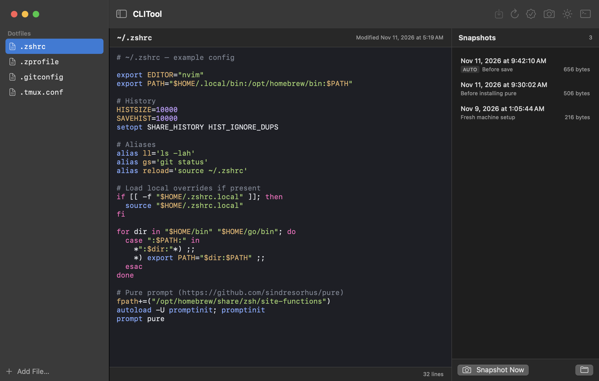

# CLITool

A small macOS app for editing, reviewing and backing up your shell config and other dotfiles. Open `~/.zshrc`, change it with syntax highlighting, check it for errors, and roll back to an earlier snapshot if something breaks.



## Features

- Lists the dotfiles in your home folder (`.zshrc`, `.zprofile`, `.gitconfig`, …) and lets you add any other config file
- Plain-text editor with syntax highlighting, and smart quotes and autocorrect switched off
- Light and dark themes
- Snapshots: take one by hand with an optional note, and one is taken automatically before every save and every restore
- Review a snapshot as a line-by-line diff against the current file, then restore or delete it
- Syntax check for shell files (`zsh -n` / `bash -n`) before you save
- Reload a file from disk, with a warning if it changed while you had unsaved edits

## Quick start

Requires macOS 13 or newer and Apple's Command Line Tools (`xcode-select --install`). Full Xcode is not needed.

```bash
./build.sh
open build/CLITool.app
```

Pick a file in the sidebar, edit it, and press ⌘S. Open a new terminal window to pick up the saved config.

## Keyboard shortcuts

| Shortcut | Action |
| --- | --- |
| ⌘S | Save (snapshots the previous version first) |
| ⌘R | Reload the file from disk |
| ⌘B | Take a snapshot of the selected file |
| ⇧⌘B | Take a snapshot of every listed file |
| ⌘K | Check shell syntax |
| ⌘T | Open a new terminal window (iTerm if installed, otherwise Terminal) |
| ⇧⌘L | Switch between the light and dark theme |
| ⌘F | Find in the editor |

## Snapshots

Snapshots are plain-text copies stored outside your home folder's dotfiles, in:

```
~/Library/Application Support/CLITool/Snapshots/
```

Each file gets its own folder holding one `.txt` per snapshot and an `index.json`. The folder button under the snapshot list opens it in Finder.

A snapshot captures the file as it is on disk, not unsaved edits in the editor. Restoring writes the snapshot back to disk after first snapshotting the current version, so a restore can itself be undone.

## Project layout

| Path | Purpose |
| --- | --- |
| `Sources/CLITool/` | SwiftUI app source |
| `Resources/` | `Info.plist` and the app icon |
| `scripts/make-icon.sh` | Regenerates the app icon |
| `scripts/make-screenshot.sh` | Regenerates `docs/example.png` using example dotfiles |
| `build.sh` | Builds and packages `build/CLITool.app` |
| `docs/` | README screenshot |

## Notes

- CLITool cannot reload config into terminal sessions that are already open. Run `source ~/.zshrc` there, or open a new window.
- The syntax highlighter is a small scanner, not a full shell parser; heredocs and other unusual constructs are colored as ordinary code.
- Saving writes through symlinks, so dotfiles linked from a dotfiles repo stay linked.
- The app is not sandboxed and is ad-hoc signed, for local use.
